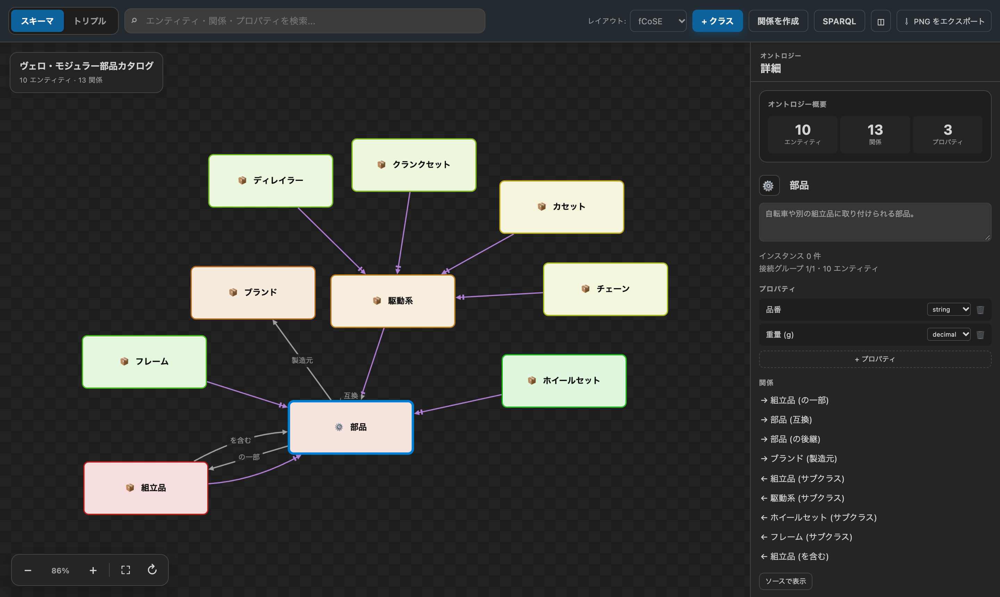
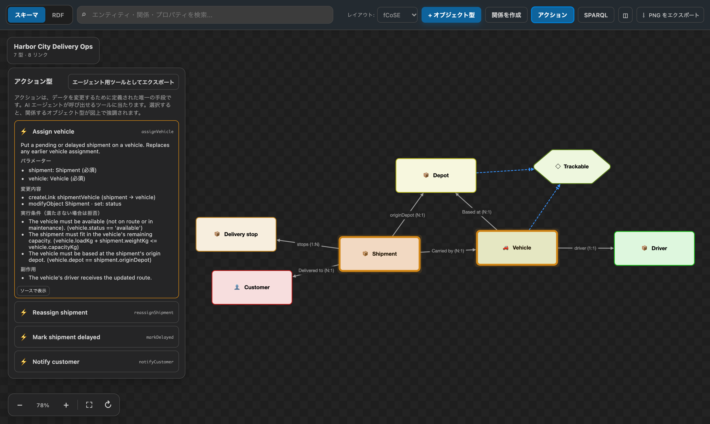
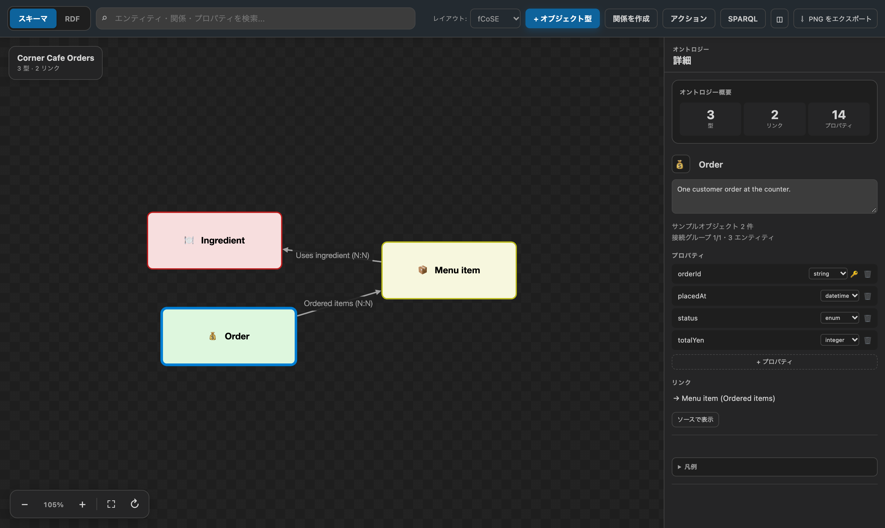
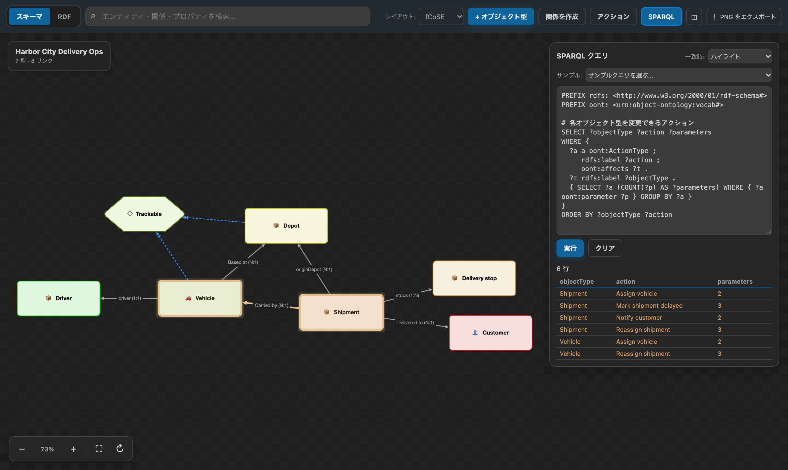

# Ontology-Driven Development for VS Code

[English](README.md)

[](https://github.com/yaggytter/vscode-ontology-driven-development/actions/workflows/ci.yml)
[](LICENSE)
[](https://code.visualstudio.com/)

要件からオントロジーを作り、そのオントロジーで開発を駆動する。**Ontology-Driven Development（ODD、オントロジー駆動開発）**は、そのための VS Code 拡張機能とコマンドラインツール（`oont`）です。オントロジーを書き、業務を知る人と一緒にレビューし、検証し、後に続くコードや AI エージェントに渡すところまでを支えます。

```text
要件（REQ-001 など）→ Object Ontology（*.oont.yaml）→ レビュー → 設計 → AI エージェントと実装 → 検証
```

- **要件からオントロジーへ**：オブジェクト型、リンク、**アクション型**（データを変えてよい操作）を、小さな YAML ファイル（Object Ontology）に書きます。`requirements:` の要件台帳と `requirements: [REQ-001]` の参照で、各要素がどの要件を実現するかをたどれます。
- **書きながら診断**：台帳にない要件 ID、どこからも参照されていない要件、参照切れ、未知のフィールドが「問題」パネルに出ます。
- **図でレビュー**：図、Inspector、アクションパネルに各要素と要件が表示されるので、業務担当者と一緒にオントロジーを確かめられます。
- **VS Code の外でも同じ検査**：`oont validate` はターミナル、CI、AI コーディングエージェントから実行できます。`oont export` は、エージェント用のツール定義、LLM 向けの要約、Turtle を、拡張機能とまったく同じ内容で書き出します。
- **図と Semantic Web の機能もそのまま**：OWL・RDF・RDFS・SKOS のビューアー、Turtle の編集、SPARQL は引き続き使えます。オントロジー駆動開発では、Object Ontology を用語集や外部の知識とつなぐ役割を担います。

はじめての方は、[オントロジー駆動開発とは](docs/ja/odd/what-is-odd.md)を読んでから、[ハンズオンのチュートリアル](docs/ja/odd/tutorial-requirements-to-ontology.md)を試してください。

> Ontology-Driven Developmentはプレビュー版です。大切なオントロジーではソース管理を有効にし、図から生成された変更をコミット前に確認してください。

> **旧 Ontology Viewer**：このプロジェクトは、開発を終えた [vscode-ontology-viewer](https://github.com/yaggytter/vscode-ontology-viewer) を引き継いだものです。新しい拡張機能として公開するため、Ontology Viewer の設定は引き継がれません。



## 要件からオントロジーへ

要件に ID を振り、オントロジーの `requirements:` 台帳に並べ、各要素にどの要件を実現するかを書きます。

```yaml
objectOntology: 1
name: 会議室予約
requirements:
  REQ-001: { title: 社員は会議室を時間指定で予約できる, source: requirements.md }
  REQ-002: 同じ会議室で時間帯が重なる予約はできない
objectTypes:
  Booking:
    primaryKey: bookingId
    requirements: [REQ-001]
    properties:
      bookingId: string
      status: { type: string, enum: [reserved, inUse, cancelled, released] }
actionTypes:
  reserveRoom:
    requirements: [REQ-001, REQ-002]
    # parameters, rules ...
    validations:
      - description: 同じ会議室の予約済み・利用中の予約と時間帯が重ならないこと
        requirements: [REQ-002]
```

- 台帳にない ID を参照するとエラー（`requirement-undefined`）、どの要素も実現していない要件は警告（`requirement-unreferenced`）になります。警告は、オントロジーを作っている間の「残りの作業の一覧」として使えます。
- Inspector とアクションパネルに各要素の要件が表示されます。SPARQL のサンプル **9. 要件と、それを実現する要素** で一覧でき、LLM 向けの要約には `## Requirements` 節が付きます。
- `x-` で始まるキーは拡張フィールドです。ツールは無視するので、`x-trigger: { kind: schedule, every: 1m }` のように、後の工程のためのメモを残せます。

**ODD: サンプルオントロジーを作成...** で **会議室予約（Object Ontology）** を選ぶと、完全な例を見られます。すべてのフィールドは[形式リファレンス](docs/ja/reference/object-ontology-format.md)で説明しています。

## `oont` CLI

会議室予約のサンプルを置いたフォルダーを検証した例です。どの要素も実現していない要件 `REQ-008` を足してあります。

```text
$ oont validate docs/ontology --strict
docs/ontology/room-booking.oont.yaml:16:3: warning: Requirement "REQ-008" is not referenced by any element. [requirement-unreferenced]
1 file checked: 0 errors, 1 warning
```

| コマンド | すること |
| --- | --- |
| `oont validate <path>... [--format text\|json] [--strict]` | ファイルやディレクトリをまとめて検証します。終了コードは、エラーなしが 0、エラーあり（`--strict` なら警告も）が 1、使い方やファイルの問題が 2 です。 |
| `oont export tools\|summary\|turtle <file> [-o <out>]` | エージェント用のツール定義、LLM 向けの要約、Turtle を書き出します。拡張機能のエクスポートと同じ内容です。 |

CLI はローカルで動き、ネットワークに接続せず、テレメトリも送りません。npm には `@yaggytter/object-ontology-cli` として公開する予定です。それまでは、このリポジトリをクローンして実行してください。

```sh
npm ci && npm run build
node packages/cli/bin/oont.js validate path/to/ontologies
```

オプション、出力形式、CI での使い方は [CLI リファレンス](docs/ja/reference/cli.md)にあります。

## 図の使いやすさ

- **読みやすいスキーマカード**: データ型プロパティをクラス内にまとめ、トリプルをすべてノードにしたときの視覚的なノイズを抑えます。
- **読みやすく意味のある配色**: 背景に合う文字色を自動選択し、関連するエンティティが同系色になる理由も表示します。
- **広く使えるズーム対応キャンバス**: 拡大・縮小、100%へのリセット、全体表示、レイアウト切替、PNG書き出しを備えています。
- **すばやい移動**: クラス、関係、プロパティを横断検索できます。ノードをダブルクリックすると、周辺だけに集中できます。
- **SPARQLクエリ**: 開いているオントロジーに対して、すべてローカルで SPARQL クエリを実行できます。結果はテキストで表示され、図にも反映されます（一致をハイライト、または一致しないものを絞り込み）。
- **画面幅に合わせたInspector**: 広い画面では図の横に表示し、狭いエディタグループでは閉じられるシートに切り替わります。
- **安全なTurtle書き戻し**: 図からの編集は、生成結果を再パースしてから反映します。クラスや関係の作成、名前変更、プロパティや説明の編集ができます。
- **英語・日本語UI**: VS Codeの表示言語に合わせて切り替わります。
- **ローカル処理**: 拡張機能からオントロジーの内容や利用状況のテレメトリを送信しません。

## 2つの方式のオントロジー：中心と接続層

オントロジー駆動開発では、Object Ontology が中心です。コードを駆動する概念と操作はここに書きます。Semantic Web のオントロジーは、それを用語集、標準の語彙、外部の知識とつなぎます。この拡張機能はどちらにも対応しています。

| | Semantic Web（OWL / RDF / SKOS） | Object Ontology（`*.oont.yaml`） |
| --- | --- | --- |
| 表すもの | 物事が何であり、どう関係するか | 業務で何を扱い、それをどう変更してよいか |
| 識別子 | 世界で一意の IRI。W3C の語彙を再利用できる | システム内の主キー |
| 変更操作 | モデル化しない（SPARQL Update は別の仕組み） | パラメーター・ルール・検証を持つ**アクション型**として定義する |
| AI との相性 | 回答の裏付け（GraphRAG、用語集、来歴） | 安全な実行（アクションがガードレール付きのエージェント用ツールになる） |

使い分けと組み合わせ方は、[使い分けガイド](docs/ja/learn/choosing-ontology-style.md)と[ユースケース集](docs/ja/learn/use-cases.md)で説明しています。

### Object Ontology の概要



```yaml
objectOntology: 1
name: Corner Cafe Orders
objectTypes:
  Order:
    primaryKey: orderId
    properties:
      orderId: { type: string }
      status: { type: string, enum: [open, preparing, served, cancelled] }
actionTypes:
  markServed:
    parameters:
      order: { type: objectRef, objectType: Order, required: true }
    rules:
      - { op: modifyObject, objectType: Order, object: order, set: { status: served } }
    validations:
      - description: Only an order that is being prepared can be served.
```

- **表示・編集・クエリ**を同じキャンバスで行えます。オブジェクト型、インターフェース（六角形）、カーディナリティ付きのリンク型を描き、**アクション**パネルで操作の定義を確認できます。図からの編集は YAML の該当箇所だけを書き換え、反映前に再パースして確認します。コメントも残ります。
- **「問題」パネルとアウトライン**: 参照切れ、未知のフィールド、サンプルオブジェクトのキー重複、台帳にない・参照されていない要件 ID を、該当箇所に表示します。同梱の JSON Schema により、`*.oont.json`（Red Hat の YAML 拡張機能を入れれば `*.oont.yaml` も）で補完が効きます。
- **SPARQL** は RDF に変換したモデル（OWL と `oont:` 語彙）に対して実行します。「各型に対して何ができるか」「オブジェクト間のリンクをたどる」「要件と、それを実現する要素」など、Object Ontology 用のクエリ例を9つ用意しています。
- **AI エージェント向けのエクスポート**は、確認しやすいよう無題のドキュメントとして開きます。アクション型の**ツール定義**（MCP や function calling で使われる JSON Schema 形式）、LLM のコンテキストに入れる Markdown の**要約**、Semantic Web のデータと組み合わせるための **Turtle** の3種類です。同じエクスポートは CLI の `oont export` でも行えます。拡張機能も CLI も、LLM やネットワークを呼び出しません。



この形式は本拡張機能独自のものです。Palantir のファイル形式ではなく、Foundry とも接続しません。

## 1分ではじめる

1. VS Code Marketplaceから**Ontology-Driven Development**をインストールします。
2. コマンドパレットから**ODD: サンプルオントロジーを作成...**を実行し、**会議室予約（Object Ontology）**を選びます。`room-booking.oont.yaml` という名前で保存します。
3. macOSでは`Cmd+Alt+O`、Windows/Linuxでは`Ctrl+Alt+O`を押します。エディタ右上の図ボタンからも開けます。
4. **Meeting room** か **Booking** を選ぶと、Inspector にプロパティ、リンク、実現する要件が表示されます。**アクション**を開くと、各アクションのルールと要件を確認できます。
5. `requirements:` 台帳に、どこからも参照されない要件を足してみてください。「問題」パネルに警告が出ます。`oont validate room-booking.oont.yaml` を実行すると、ターミナルでも同じ結果になります。

詳しい手順は[はじめにガイド](docs/ja/getting-started.md)、[ODD チュートリアル](docs/ja/odd/tutorial-requirements-to-ontology.md)、ほかの[チュートリアル](docs/ja/)にまとめています。OWL や RDF は、`.ttl` ファイルを開いて同じショートカットを押すと図で表示できます。

## 主な機能

### 探索する

- クラス中心の**スキーマビュー**と、主語・述語・目的語を表示する**トリプルビュー**を切り替えられます。
- エンティティの検索とフォーカス、入出力関係の確認、エンティティ・関係・プロパティ件数の把握ができます。
- ノードをドラッグして配置できます。同じファイルの図を開き直しても、ビューごとの位置が復元されます。
- 有機的に広がる`fcose`と、階層を追いやすい`dagre`のレイアウトを選べます。
- 現在の図をPNGに、保存済みレイアウトをJSONに書き出せます。

### SPARQLで検索する

ツールバーの **SPARQL** ボタンでパネルを開くと、開いているオントロジーに対して SPARQL 1.1 クエリを実行できます。SELECT・ASK・CONSTRUCT/DESCRIBE に対応しています。**実行**ボタンか `Ctrl`/`Cmd`+`Enter` で実行します。

SPARQL がはじめての方へ: パネルには、どのオントロジーでも動く9つのサンプルクエリが用意されています。「とにかく何か表示する」から OPTIONAL、FILTER、集計、ASK、CONSTRUCT へと進む順序です。選んで実行するだけで試せます。[SPARQL チュートリアル](docs/ja/learn/tutorial-4-sparql.md) で順を追って解説しています。

結果はテキストで表示され（SELECT はバインディングの表、ASK は真偽値、CONSTRUCT は主語・述語・目的語の行）、図にも反映されます。

- **ハイライト**: 一致したノードと接続エッジを強調し、他のグラフはそのまま表示します。
- **絞り込み**: 一致しなかったものを淡色化します。検索ボックスやダブルクリックのフォーカスと組み合わせられます。
- **グラフに反映しない**: テキストの結果のみを表示します。



クエリは拡張機能ホスト内（[Comunica](https://comunica.dev/) を利用）でローカルに実行され、オントロジーの内容が外部に送信されることはありません。

### 安全に編集する

Turtleファイルでは、図からクラスや関係を作成し、エンティティ名、プロパティ、説明を編集できます。変更候補はメモリ上で適用し、再パースに成功した場合だけソースへ反映します。検証に失敗しても、元のファイルは変更されません。

テキスト編集も補助します。Turtleではアウトライン、ホバー、補完、**シンボルの名前変更（F2）**を利用できます。

### 既存のオントロジーを取り込む

RDF/XMLとJSON-LDはそのまま表示できます。図から編集したい場合は、**ODD: 編集用にTurtleへ変換...**を実行してください。変換結果は新しい文書として作成し、元ファイルを上書きしません。

## 対応形式

| 形式 | 拡張子 | 図で表示 | 図から編集 |
| --- | --- | :---: | :---: |
| Turtle | `.ttl`, `.turtle` | 対応 | 対応 |
| TriG | `.trig` | 対応 | 非対応 |
| N-Triples | `.nt` | 対応 | 非対応 |
| Notation3 | `.n3` | 対応 | 非対応 |
| RDF/XML / OWL/XML | `.rdf`, `.owl` | 対応 | 変換後に対応 |
| JSON-LD | `.jsonld` | 対応 | 変換後に対応 |
| Object Ontology（YAML） | `.oont.yaml`, `.oont.yml` | 対応 | 対応 |
| Object Ontology（JSON） | `.oont.json` | 対応 | YAML へ変換後に対応 |

SPARQL による問い合わせは、この表のすべての形式で利用できます。パース済みのトリプル（Object Ontology の場合は RDF に変換したモデル）に対して実行されるため、変換は不要です。

パーサーや編集範囲の詳細は[対応形式](docs/ja/reference/format-support.md)をご覧ください。

## コマンド

| コマンド | 既定のキーバインド |
| --- | --- |
| ODD: 図でプレビューを開く | `Cmd+Alt+O` / `Ctrl+Alt+O` |
| ODD: 編集用にTurtleへ変換... | — |
| ODD: 図のレイアウトをJSONでエクスポート... | — |
| ODD: サンプルオントロジーを作成... | — |
| ODD: アクションを AI エージェント用ツール定義 (JSON Schema) としてエクスポート... | — |
| ODD: LLM コンテキスト用のオントロジー要約をエクスポート... | — |
| ODD: Object Ontology を Turtle (OWL) としてエクスポート... | — |
| ODD: Object Ontology の JSON を編集用に YAML へ変換... | — |

`Cmd+Shift+O` / `Ctrl+Shift+O`は、VS Code標準の**エディター内のシンボルへ移動**に割り当てたままです。

## 設定

| 設定項目 | 既定値 | 説明 |
| --- | --- | --- |
| `ontologyDrivenDevelopment.preview.autoRefreshDebounceMs` | `300` | ソース編集後に図を更新するまでの待機時間（ミリ秒）。 |
| `ontologyDrivenDevelopment.preview.defaultView` | `schema` | 最初に開くビュー。`schema`または`triples`。 |
| `ontologyDrivenDevelopment.preview.layout` | `fcose` | 自動レイアウト。`fcose`または`dagre`。 |

## ドキュメントとサポート

- [はじめに](docs/ja/getting-started.md)
- オントロジー駆動開発：[オントロジー駆動開発とは](docs/ja/odd/what-is-odd.md)・[チュートリアル：要件からオントロジーを作る](docs/ja/odd/tutorial-requirements-to-ontology.md)
- リファレンス：[Object Ontology 形式](docs/ja/reference/object-ontology-format.md)・[CLI（`oont`）](docs/ja/reference/cli.md)
- [最初のオントロジーを作る](docs/ja/learn/tutorial-1-first-ontology.md)
- [図から編集する](docs/ja/learn/tutorial-2-editing-from-diagram.md)
- [既存のOWLファイルを取り込む](docs/ja/learn/tutorial-3-importing-owl.md)
- [SPARQLで問い合わせる](docs/ja/learn/tutorial-4-sparql.md)
- [はじめての Object Ontology](docs/ja/learn/tutorial-5-object-ontology.md)
- [Object Ontology × AI エージェント](docs/ja/ai/tutorial-6-object-ontology-ai-agents.md)
- [Semantic Web オントロジー × LLM](docs/ja/ai/tutorial-7-semantic-web-llm.md)
- [Claude Code で動かす — Object Ontology とエージェント](docs/ja/ai/tutorial-8-claude-code-object-ontology.md)
- [Claude Code で動かす — Semantic Web と根拠のある回答](docs/ja/ai/tutorial-9-claude-code-semantic-web.md)
- [オントロジー方式の選び方](docs/ja/learn/choosing-ontology-style.md)・[ユースケース集](docs/ja/learn/use-cases.md)
- [対応形式](docs/ja/reference/format-support.md)
- [トラブルシューティング](docs/ja/reference/troubleshooting.md)
- [サポート](SUPPORT.ja.md)・[プライバシー](PRIVACY.ja.md)・[セキュリティ](SECURITY.ja.md)
- [コントリビューション](CONTRIBUTING.ja.md)・[変更履歴](CHANGELOG.ja.md)

不具合を報告する前に、[トラブルシューティング](docs/ja/reference/troubleshooting.md)をご確認ください。再現可能な不具合や具体的な機能提案は、[GitHub Issues](https://github.com/yaggytter/vscode-ontology-driven-development/issues)で受け付けています。

## プライバシーと信頼性

Ontology-Driven Developmentは、VS Codeの拡張機能ホストとWebview内でオントロジーを処理します。テレメトリ、広告、アカウント機能、拡張機能独自のネットワークサービスは含みません。`oont` CLI もローカルのファイルだけを扱い、ネットワークに接続せず、テレメトリも送りません。正確なデータの流れは[プライバシーに関する通知](PRIVACY.ja.md)、脆弱性の報告方法は[セキュリティポリシー](SECURITY.ja.md)をご覧ください。

## ライセンス

[MIT License](LICENSE)で公開しています。同梱する依存パッケージの表示は[THIRD_PARTY_NOTICES.md](THIRD_PARTY_NOTICES.md)にまとめています。
