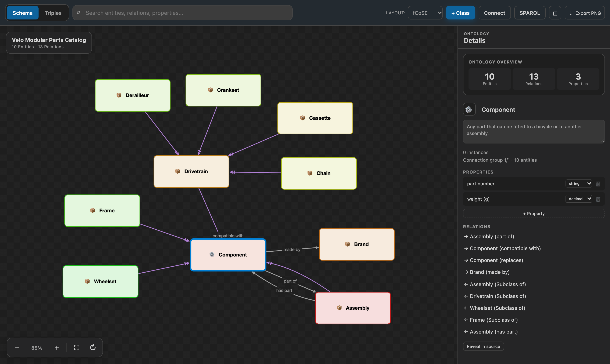
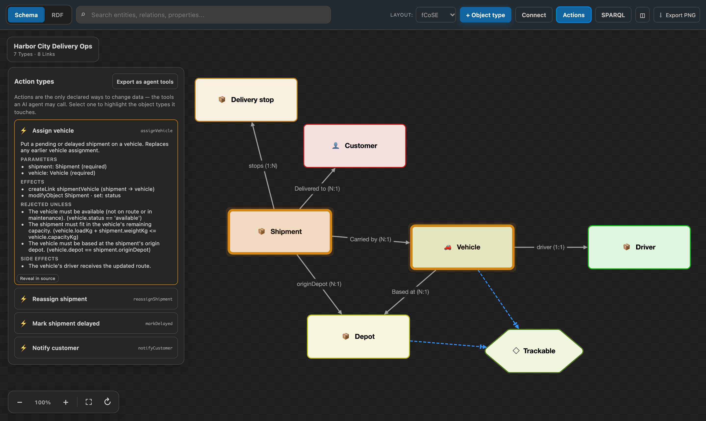
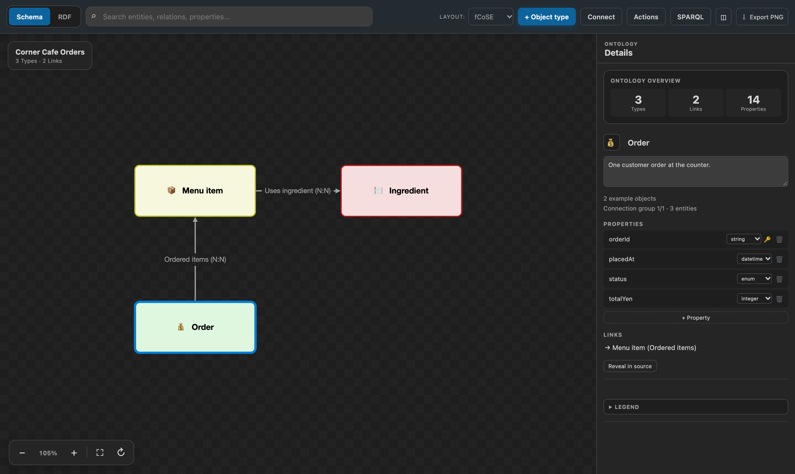
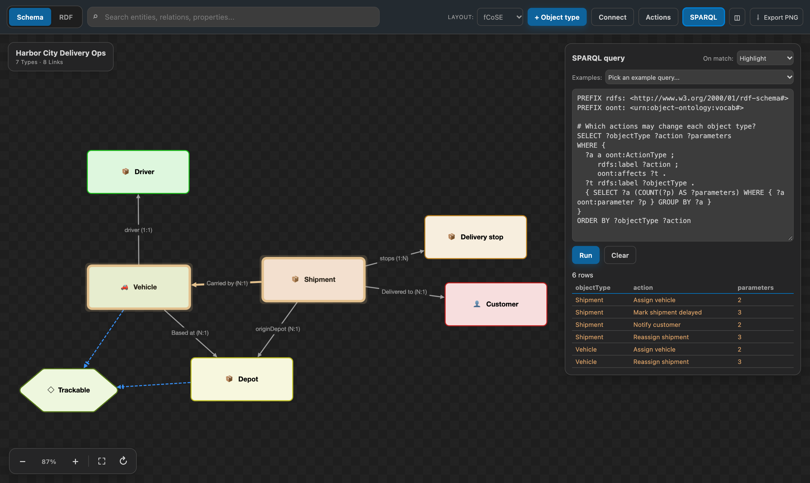

# Ontology-Driven Development for VS Code

[日本語](README.ja.md)

[](https://github.com/yaggytter/vscode-ontology-driven-development/actions/workflows/ci.yml)
[](LICENSE)
[](https://code.visualstudio.com/)

Build an ontology from your requirements, and let it drive development. **Ontology-Driven Development (ODD)** is a VS Code extension and a command-line tool (`oont`) for writing that ontology, reviewing it with the people who know the business, checking it, and handing it to the code and the AI agents that come after.

```text
Requirements (REQ-001, ...) → Object Ontology (*.oont.yaml) → Review → Design → Implementation with AI agents → Verification
```

- **Requirements to ontology.** Write object types, links and **action types** (the operations allowed to change data) in a small YAML file, the Object Ontology. A `requirements:` registry and `requirements: [REQ-001]` references trace every element back to the requirement it realizes.
- **Diagnostics as you type.** Undefined and unreferenced requirement IDs, broken references and unknown fields show up in the Problems panel.
- **Review in a diagram.** The diagram, the Inspector and the Actions panel show each element with its requirements, so you can walk through the ontology with the business.
- **The same checks outside VS Code.** `oont validate` runs in a terminal, in CI or from an AI coding agent. `oont export` writes the agent tool definitions, the LLM context summary and Turtle, exactly as the extension does.
- **Diagrams and Semantic Web support remain.** The OWL, RDF, RDFS and SKOS viewer, Turtle editing and SPARQL are all still here. In ODD they connect the Object Ontology to glossaries and external knowledge.

New to the idea? Read [What Is Ontology-Driven Development?](docs/en/odd/what-is-odd.md), then try the [hands-on tutorial](docs/en/odd/tutorial-requirements-to-ontology.md).

> Ontology-Driven Development is in preview. Keep source control enabled for important ontologies and review diagram-generated changes before committing them.

> **Formerly Ontology Viewer.** This project continues [vscode-ontology-viewer](https://github.com/yaggytter/vscode-ontology-viewer), which is no longer developed. It is published as a new extension, so settings from Ontology Viewer are not carried over.



## From requirements to an ontology

Give each requirement an ID, list the IDs in the ontology's `requirements:` registry, and say on each element which requirements it realizes:

```yaml
objectOntology: 1
name: Meeting Room Booking
requirements:
  REQ-001: { title: Members can book a room for a time range, source: requirements.md }
  REQ-002: No overlapping bookings for the same room
objectTypes:
  Booking:
    primaryKey: bookingId
    requirements: [REQ-001]
    properties:
      bookingId: string
      status: { type: string, enum: [reserved, inUse, cancelled, released] }
actionTypes:
  reserveRoom:
    requirements: [REQ-001, REQ-002]
    # parameters, rules ...
    validations:
      - description: No other reserved or in-use booking of the same room may overlap.
        requirements: [REQ-002]
```

- A reference to an ID that is not in the registry is an error (`requirement-undefined`). A requirement that no element realizes is a warning (`requirement-unreferenced`), which works as a to-do list while you build the ontology.
- The Inspector and the Actions panel show each element's requirements. The SPARQL example **9. Requirements and the elements that realize them** lists them all, and the LLM context summary gets a `## Requirements` section.
- Keys starting with `x-` are extension fields. Tools ignore them, so you can keep notes for later phases, such as `x-trigger: { kind: schedule, every: 1m }`.

Run **ODD: Create Sample Ontology...** and pick **Meeting Room Booking (Object Ontology)** to see a complete example. The [format reference](docs/en/reference/object-ontology-format.md) covers every field.

## The `oont` CLI

Here it checks a folder holding the Meeting Room Booking sample, after a requirement `REQ-008` was added that no element realizes yet:

```text
$ oont validate docs/ontology --strict
docs/ontology/room-booking.oont.yaml:16:3: warning: Requirement "REQ-008" is not referenced by any element. [requirement-unreferenced]
1 file checked: 0 errors, 1 warning
```

| Command | What it does |
| --- | --- |
| `oont validate <path>... [--format text\|json] [--strict]` | Checks files or whole directories. Exit code 0 means no errors, 1 means errors (or warnings with `--strict`), 2 means a usage or file problem. |
| `oont export tools\|summary\|turtle <file> [-o <out>]` | Writes the agent tool definitions, the LLM context summary or Turtle, identical to the extension's exports. |

The CLI runs locally, with no network access and no telemetry. It will be published to npm as `@yaggytter/object-ontology-cli`. Until then, run it from a clone of this repository:

```sh
npm ci && npm run build
node packages/cli/bin/oont.js validate path/to/ontologies
```

See the [CLI reference](docs/en/reference/cli.md) for options, output formats and CI use.

## A diagram you will enjoy using

- **Readable schema cards** keep datatype properties inside their class instead of turning every triple into visual noise.
- **Accessible, meaningful colors** automatically choose readable node text and explain how related entities form color families.
- **A spacious, zoomable canvas** includes zoom in/out, reset to 100%, fit-to-screen, layout switching, and PNG export.
- **Fast navigation** searches classes, relations, and properties. Double-clicking a node focuses its neighborhood.
- **SPARQL queries** run against the open ontology, entirely on your machine, with results shown as text and reflected on the diagram (highlight matches or filter out the rest).
- **An adaptive Inspector** stays beside the graph on wide screens and becomes a dismissible sheet in narrow editor groups.
- **Safe Turtle write-back** re-parses every generated edit before accepting it. Create classes and relations, rename entities, and edit properties or descriptions directly from the diagram.
- **English and Japanese UI** follows the VS Code display language.
- **Local-first operation** sends no ontology contents or usage telemetry from the extension.

## Two styles of ontology: the center and the connection layer

In ontology-driven development, the Object Ontology is the center: it holds the concepts and the operations that drive the code. Semantic Web ontologies connect it to glossaries, standard vocabularies and external knowledge. The extension supports both.

| | Semantic Web (OWL / RDF / SKOS) | Object Ontology (`*.oont.yaml`) |
| --- | --- | --- |
| Answers | What things are and how they relate | What the business operates on, and how it may change |
| Identity | Global IRIs, reusable W3C vocabularies | Primary keys inside one system |
| Changes | Not modeled (SPARQL Update is separate) | First-class **action types** with parameters, rules and validations |
| Best AI fit | Grounding answers: GraphRAG, glossaries, provenance | Acting safely: actions become typed agent tools with guard rails |

The [choosing guide](docs/en/learn/choosing-ontology-style.md) and the [use-case catalog](docs/en/learn/use-cases.md) explain when to use which, and how to combine them.

### Object Ontology at a glance



```yaml
objectOntology: 1
name: Corner Cafe Orders
objectTypes:
  Order:
    primaryKey: orderId
    properties:
      orderId: { type: string }
      status: { type: string, enum: [open, preparing, served, cancelled] }
actionTypes:
  markServed:
    parameters:
      order: { type: objectRef, objectType: Order, required: true }
    rules:
      - { op: modifyObject, objectType: Order, object: order, set: { status: served } }
    validations:
      - description: Only an order that is being prepared can be served.
```

- **Diagram, edit, and query** with the same canvas: object types, interfaces (hexagons), link types with cardinality badges, and an **Actions** panel. Diagram edits are surgical YAML changes that are re-parsed before they are applied, and comments are kept.
- **Problems and outline**: broken references, unknown fields, duplicate example keys, and undefined or unreferenced requirement IDs are reported at their exact location. A bundled JSON Schema adds completion for `*.oont.json` (and for `*.oont.yaml` with the Red Hat YAML extension).
- **SPARQL** runs over an RDF projection (OWL + an `oont:` vocabulary), with nine Object-Ontology example queries such as "what can be done to each type?", "follow links between objects" and "requirements and the elements that realize them".
- **AI-agent exports** open as untitled documents for you to review: action types as **tool definitions** (JSON Schema, the shape used by MCP and function-calling APIs), a compact **LLM context summary** in Markdown, and **Turtle** for combining with Semantic Web data. The same exports are available from the CLI as `oont export`. Neither the extension nor the CLI calls an LLM or the network.



The format is this extension's own; it is not Palantir's file format and does not connect to Foundry.

## Get started in one minute

1. Install **Ontology-Driven Development** from the VS Code Marketplace.
2. Run **ODD: Create Sample Ontology...** from the Command Palette and pick **Meeting Room Booking (Object Ontology)**. Save it as `room-booking.oont.yaml`.
3. Press `Cmd+Alt+O` on macOS or `Ctrl+Alt+O` on Windows/Linux. You can also use the diagram button in the editor title bar.
4. Select **Meeting room** or **Booking**. The Inspector lists its properties, links and the requirements it realizes. Open **Actions** to see each action with its rules and requirements.
5. Add a requirement to the `requirements:` registry that nothing references, and watch the warning appear in the Problems panel. Then run `oont validate room-booking.oont.yaml` for the same result in a terminal.

Continue with the [Getting Started guide](docs/en/getting-started.md), the [ODD tutorial](docs/en/odd/tutorial-requirements-to-ontology.md) or the other [tutorials](docs/en/). For OWL and RDF, open any `.ttl` file and press the same shortcut.

## What you can do

### Explore

- Switch between a class-focused **Schema** view and a raw **Triples** view.
- Search and focus entities, inspect incoming and outgoing relations, and see entity/relation/property counts.
- Drag nodes into a useful arrangement; positions are remembered per file and view when you reopen the diagram.
- Choose the organic `fcose` layout or layered `dagre` layout.
- Export the current diagram as PNG or its saved layout as JSON.

### Query with SPARQL

Open the **SPARQL** panel from the toolbar to run SPARQL 1.1 queries against the ontology you have open. SELECT, ASK, and CONSTRUCT/DESCRIBE are supported. Press **Run** or `Ctrl`/`Cmd`+`Enter` to execute.

New to SPARQL? The panel ships nine example queries that work on any ontology, ordered from "show me anything" up through OPTIONAL, FILTER, aggregation, ASK, and CONSTRUCT — pick one and run it. The [SPARQL tutorial](docs/en/learn/tutorial-4-sparql.md) walks through them.

Results show as text — a table of bindings for SELECT, a boolean for ASK, or subject/predicate/object rows for CONSTRUCT — and are reflected on the diagram:

- **Highlight** accents matching nodes and their connecting edges while keeping the rest of the graph visible.
- **Filter** dims everything the query did not match, and composes with the search box and double-click focus.
- **No graph effect** shows the text result only.



Queries execute locally in the extension host (powered by [Comunica](https://comunica.dev/)); no ontology contents leave your machine.

### Edit safely

Turtle files support diagram editing. You can create classes and relations, rename entities, add/rename/retype/delete properties, and edit descriptions. Every write is applied to an in-memory candidate and re-parsed first. If verification fails, the source file is left unchanged.

Text editing remains first-class: Turtle also has outline, hover, completion, and **Rename Symbol (F2)** support.

### Bring existing ontologies

RDF/XML and JSON-LD are viewable directly. Use **ODD: Convert to Turtle for Editing...** when you want diagram write-back. The conversion creates a new document and does not overwrite the source file.

## Format support

| Format | Extensions | Diagram | Edit from diagram |
| --- | --- | :---: | :---: |
| Turtle | `.ttl`, `.turtle` | Yes | Yes |
| TriG | `.trig` | Yes | No |
| N-Triples | `.nt` | Yes | No |
| Notation3 | `.n3` | Yes | No |
| RDF/XML / OWL/XML | `.rdf`, `.owl` | Yes | Convert first |
| JSON-LD | `.jsonld` | Yes | Convert first |
| Object Ontology (YAML) | `.oont.yaml`, `.oont.yml` | Yes | Yes |
| Object Ontology (JSON) | `.oont.json` | Yes | Convert to YAML first |

SPARQL querying works on every format in this table — it runs against the parsed triples (or, for Object Ontology files, their RDF projection), so no conversion is needed.

See [Format Support](docs/en/reference/format-support.md) for parser and editing details.

## Commands

| Command | Default keybinding |
| --- | --- |
| ODD: Open Diagram Preview | `Cmd+Alt+O` / `Ctrl+Alt+O` |
| ODD: Convert to Turtle for Editing... | — |
| ODD: Export Diagram Layout as JSON... | — |
| ODD: Create Sample Ontology... | — |
| ODD: Export Actions as AI Agent Tools (JSON Schema)... | — |
| ODD: Export Ontology Summary for LLM Context... | — |
| ODD: Export Object Ontology as Turtle (OWL)... | — |
| ODD: Convert Object Ontology JSON to YAML for Editing... | — |

`Cmd+Shift+O` / `Ctrl+Shift+O` remains VS Code's built-in **Go to Symbol in Editor** command.

## Settings

| Setting | Default | Description |
| --- | --- | --- |
| `ontologyDrivenDevelopment.preview.autoRefreshDebounceMs` | `300` | Delay in milliseconds before a source edit refreshes the diagram. |
| `ontologyDrivenDevelopment.preview.defaultView` | `schema` | Initial view: `schema` or `triples`. |
| `ontologyDrivenDevelopment.preview.layout` | `fcose` | Automatic layout: `fcose` or `dagre`. |

## Documentation and help

- [Getting Started](docs/en/getting-started.md)
- Ontology-driven development: [What Is ODD?](docs/en/odd/what-is-odd.md) · [Tutorial: From Requirements to an Ontology](docs/en/odd/tutorial-requirements-to-ontology.md)
- Reference: [Object Ontology Format](docs/en/reference/object-ontology-format.md) · [CLI (`oont`)](docs/en/reference/cli.md)
- [Build Your First Ontology](docs/en/learn/tutorial-1-first-ontology.md)
- [Edit From the Diagram](docs/en/learn/tutorial-2-editing-from-diagram.md)
- [Import an Existing OWL File](docs/en/learn/tutorial-3-importing-owl.md)
- [Ask Questions with SPARQL](docs/en/learn/tutorial-4-sparql.md)
- [Your First Object Ontology](docs/en/learn/tutorial-5-object-ontology.md)
- [Object Ontology × AI Agents](docs/en/ai/tutorial-6-object-ontology-ai-agents.md)
- [Semantic Web Ontologies × LLMs](docs/en/ai/tutorial-7-semantic-web-llm.md)
- [Run It with Claude Code — Object Ontology Agents](docs/en/ai/tutorial-8-claude-code-object-ontology.md)
- [Run It with Claude Code — Semantic Web Answers](docs/en/ai/tutorial-9-claude-code-semantic-web.md)
- [Choosing an Ontology Style](docs/en/learn/choosing-ontology-style.md) · [Use Cases](docs/en/learn/use-cases.md)
- [Format Support](docs/en/reference/format-support.md)
- [Troubleshooting](docs/en/reference/troubleshooting.md)
- [Support](SUPPORT.md) · [Privacy](PRIVACY.md) · [Security](SECURITY.md)
- [Contributing](CONTRIBUTING.md) · [Changelog](CHANGELOG.md)

Before opening an issue, check the [troubleshooting guide](docs/en/reference/troubleshooting.md). Bugs and focused feature requests are welcome in [GitHub Issues](https://github.com/yaggytter/vscode-ontology-driven-development/issues).

## Privacy and trust

Ontology-Driven Development processes ontology documents locally in the VS Code extension host and webview. The extension does not include telemetry, advertising, accounts, or an extension-owned network service. The `oont` CLI also works only on local files, with no network access and no telemetry. See the [Privacy Notice](PRIVACY.md) for the exact data flow and the [Security Policy](SECURITY.md) for reporting vulnerabilities.

## License

Released under the [MIT License](LICENSE). Bundled dependency notices are listed in [THIRD_PARTY_NOTICES.md](THIRD_PARTY_NOTICES.md).
